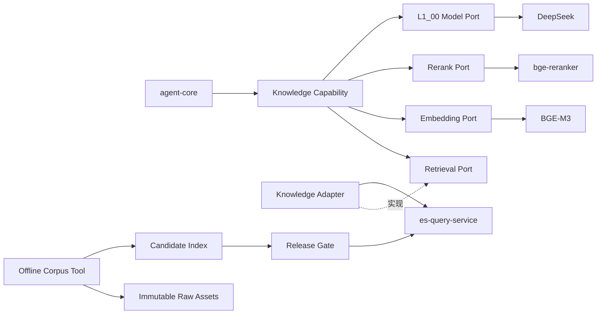

# [L1_01] 单体 Agent 知识查询能力架构

> 文档层级：L1
> 文档状态：Approved

## 1. 文档信息

| 项目 | 内容 |
|---|---|
| 文档编号 | `L1_01` |
| 文档层级 | L1 能力架构 |
| 文档状态 | Approved |
| 当前版本 | v3.0 |
| 日期 | 2026-09-14 |
| 权威范围 | Knowledge 在线查询，以及阶段 A 离线语料审计、版本化处理、候选索引与受控发布边界 |
| 上位文档 | [`L0_00` v3.0](L0_00_SINGLE_AGENT_ARCHITECTURE.md) |
| 关联 L1 | [`L1_00`](L1_00_SINGLE_AGENT_CORE_RUNTIME_ARCHITECTURE.md)、[`L1_02`](L1_02_SINGLE_AGENT_BUSINESS_QUERY_ADAPTER_ARCHITECTURE.md) |
| 下位文档 | [`L2_01_00`](L2_01_00_SINGLE_AGENT_KNOWLEDGE_QUERY_FLOW_CONFIGURATION_DETAILED_DESIGN.md)、[`L2_01_01`](L2_01_01_SINGLE_AGENT_KNOWLEDGE_RETRIEVAL_LOCAL_MODEL_DETAILED_DESIGN.md)、[`L2_01_02`](L2_01_02_SINGLE_AGENT_KNOWLEDGE_EVIDENCE_EGRESS_SUMMARY_EFFECTIVENESS_DETAILED_DESIGN.md) |
| 实施状态 | 在线生产源码单绑定Rewrite V11、Summary V7、质量策略V3和阶段A离线语料处理已实施；当前对象图定向non-live已验证，未部署新版，模型选域、适用性证明及完整真实专项仍未通过；具体Gate/UAT、证据与评审状态由P3/UAT_01管理 |
| 归档来源 | [整理前 v1.25 原文](历史文档/2026-09-14-unified-v3-baseline/L1_01_SINGLE_AGENT_KNOWLEDGE_QUERY_ARCHITECTURE.md)；[完整性清单](../历史文档/2026-09-14-unified-v3-baseline/README.md) |

修订历史：2026-09-14，整理纳入统一文档基线v3.0；原版本、源提交及完整字节归档见上表。本次版本序列重置不是代码或设计回滚，评审、实施、部署和UAT状态分别管理。

本轮v3.0经三轮内审及两轮同一执行者的分层/跨层正式复核通过；仅证明文档整合，不表示新实现、部署或UAT已完成。完整发现与验证见本次归档MIGRATION.md。

## 2. 阅读导航

§4.5为已批准待实施的在线最小方案，§4.6为资料组织方案；§5～10保留统一链路、typed接口、授权/出域/引用及生命周期。§14区分源码与目标。历史证明链、锚点/配额和实验流水归档，不需要读末尾补丁推断当前规则。

## 3. 来源与取舍

### 3.1 保留的设计

- 一个`knowledge.query`承接受控意图、多逻辑域、有界召回/重排和证据化回答；目标首期不强制问题改写。
- Knowledge 使用 Capability → Retrieval Port ← Adapter；不新建独立 `knowledge-service`。
- Capability 拥有查询策略；Adapter 只拥有逻辑域→稳定 Profile 映射；`es-query-service` 独占 Profile→物理资源映射。
- 候选正文必须在 Retrieval Provider 边界完成当前用户读取授权后才可进入 Agent、融合或 BGE Rerank。
- 关键词与向量等路径返回统一候选；融合不直接比较异构原始分数。
- 领域结果、证据上下文和模型安全载荷是三个不同视图。
- Knowledge 出域采用全局 ∩ 逻辑域默认 ∩ 文档级收紧策略，缺失、未知或冲突失败关闭。
- 整域授权拒绝和读取权威失败优先于其他域成功；仅技术性单路失败允许在证据充分时受控继续。
- P5 结论可以是 `effective`、`partially_effective`、`ineffective` 或 `invalid_run`；最新有效效果等级为 `partially_effective`，不等于整体效果达标。候选和运行明细只由 UAT_01/evidence 保存。
- 安全负例以“模型零调用”验收，不能同时作为摘要有效完成率的失败样本；显式 `gold_issue` 必须由独立数据质量门禁约束，不能混入模型忠实度或可用性归因。普通 `no_result`、`insufficient_evidence`、技术失败和超时仍保留在各自适用的效果分母中。

### 3.2 简化内容

移除旧版逐次门禁、candidate/manifest/hash、评审流水、已解决外部前提和重复状态。历史细节见归档；当前文档只治理稳定流程、契约、安全和效果结论含义。

### 3.3 本次整合

整理前策略及逐轮过程已归档：[原文](历史文档/2026-09-14-unified-v3-baseline/L1_01_SINGLE_AGENT_KNOWLEDGE_QUERY_ARCHITECTURE.md)。KQ-AD-020～028为已经批准、尚待实施的主线决策；既有安全、来源和离线发布职责保留。 稳定编号的适用/替代范围见[新旧映射](../历史文档/2026-09-14-unified-v3-baseline/MIGRATION.md)，不得作为新实施的并行合同。

## 4. 目标、范围与上位约束

### 4.1 目标

在一个只读动作中，把用户问题转换为可追踪的知识证据和受证据约束的回答；模型、检索基础设施或任一局部失败均不得扩大权限、访问物理资源或生成无依据事实。

### 4.2 范围内

- `knowledge.query` 描述、配置和请求级阶段；
- 查询意图、逻辑知识域选择、原问检索计划、多路召回、融合与重排；改写仅保留历史解释与后续对照边界；
- Knowledge Adapter、`es-query-service` 类型化只读消费、本地 BGE 消费；
- 读取授权、证据、三层出域、摘要和 P5 效果验证。
- 官方公开正文/附件的只读审计、离线受控获取、解析/OCR、结构化切片、embedding、候选索引及受控 alias 发布。

### 4.3 范围外

- 在线文档录入、用户上传、内容编辑、通用内容管理平台；
- 图谱、语料再导入、未评审的索引重建与公共 DTO/公开枚举变更；现有政策向量表示能力见L2_01_01 §12.8，后续候选构建/发布仍须独立授权并满足L2合同；
- 知识图谱、图数据库和第二套 Knowledge 在线链路；
- BGE 服务内部实现，以及 `es-query-service` 既有类型化检索合同之外的内部治理；
- Employee/Transaction、业务角色和业务字段出域；
- 公共 Runtime、DeepSeek transport、HTTP 协议字段和通用错误码；
- 独立 Knowledge 服务、持久工作流和生产级检索平台。

### 4.4 L0 约束映射

| L0 约束 | 本文落实 |
|---|---|
| `L0_00 §3/§7；SA-AD-005` | 只注册一个 `knowledge.query`，内部完整实现四项能力 |
| `L0_00 §5/§8` | 模型结果不可信；肯定内容必须由本次证据支撑 |
| `L0_00 §3/§5/§8` | 强类型配置只收紧；端口隔离检索和模型；契约变化同步测试 |
| `L0_00 §5；SA-AD-004` | 用户 JWT 必需；敏感问题、正文、向量、密钥不进入日志或未授权模型输入 |
| `L0_00 §5（请求生命周期）` | 计划、候选、证据、摘要均为请求级，不持久化知识副本 |
| `L0_00 §3；SA-AD-006` | 模型不可指定物理资源；ES 只提供类型化只读原子检索 |
| `L0_00 §3/§7（编排边界）` | Knowledge 只编排动作内部阶段，不取得 LangGraph 的跨动作权威 |
| `L0_00 §5/§8（出域失败关闭）` | 三层只收紧出域，任何未知或冲突拒绝 |

`L0_00 SA-AD-001～004`中的Business专属规则不在本文重定义；以上以现行L0章节和决策为准，不再引用归档SA-C编号。

### 4.5 Knowledge 设计重建（后续实施权威）

#### 4.5.1 事实、推断与问题定位

事实基线与Git比较范围见P3 §21.1。当前源码是Rewrite11/Summary7/quality-v3，不是待实施方案；配置模型影响所有DeepSeek任务，代码回滚不能恢复独立的索引/服务实例。已有成功原文、人评和non-live只证明各自切片。当前实例部署、全套新版本真实效果及回滚后的效果优劣均未验证。

已证实：现规划输出包含域、问题类型、改写、证明需求、focus及缺失条件；需求随后参与重排、锚点选择与Summary coverage校验。有限失败证据证明模型输出曾在域合同处失败，但不足以从未保存的原始响应确定更细原因。**有依据的设计推断**：多个阶段依赖同一次模型对证明结构的自声明，扩大结构失败面及语义错误传播；声明齐全不证明原文蕴含。不能据此承诺简化后召回一定提高。

#### 4.5.2 最终保留／重设计／退出决策

| 条目 | 当前职责/证据 | 决策及理由 | 影响与后续处理 |
|---|---|---|---|
| Business、auth、公共HTTP/DTO | Git比较中业务域及公共契约无相关修改；共享model有变化 | 保留；不是Knowledge失败的修复目标 | 三动作/安全测试防回退，不改业务设计 |
| 单Capability、Core选择、disabled及owned clients | main/bootstrap当前对象图 | 保留职责；避免改Core路由或第二在线流程 | 新任务仍位于同一Knowledge Provider，disabled零依赖 |
| 读取守卫、三层出域、Question Guard | Java read guard、policy、Guard源码 | 保留；安全而非相关性启发式 | 不按“命中率”放宽，不暴露正文/凭据 |
| 来源/hash、Evidence/ref/连续子串/唯一性 | integrity及extractive validator | 保留；只证明来源及文本完整性 | 不把机械校验等同语义充分 |
| 阶段A资产、父子关系、typed Profile及发布回滚 | 阶段A证据和当前binding文件 | 保留；语料与在线算法分属不同平面 | 本目标零索引操作，后续也不默认回退向量 |
| keyword/vector、RRF、BGE端口 | retrieval组件和合同 | 保留组件，重设计组合策略 | 原问双路、每域一次rerank、固定预算与稳定排序 |
| 动作选择/选域/Rewrite | 当前selector后还有复杂规划 | 重设计；不把三类任务合成证明引擎 | Core只选动作；轻量规划只判模式/域/缺条件，首期不生成检索改写 |
| requirements/focus/coverage声明 | 当前quality-v3跨阶段传播 | 退出新主线的强制证明合同；未证明净收益且耦合高 | 新内部合同不携带这些字段；保留旧源码/冻结调用方至后续清理核实 |
| 锚点、父配额、0.5准入 | 有局部同池改善，非全局保证 | 重设计；效果策略不能成为安全公理 | 首期无证明锚点、无父配额、无裸分绝对门槛；保留域来源机会和总预算，噪声风险实测 |
| Summary及适用性判断 | V7抽取+模型自报coverage | 重设计为按模式的原文选择，不新增自由生成 | 新任务无coverage自报；本地继续原校验，原问显式条件由模型/人工核对 |
| 失败语义 | 现有no_result reason与技术错误 | 保留公开合同，明确每阶段原因 | 不把未命中/缺证据/缺条件/技术失败混成一个结论 |
| 向量表示、模型切换与启动预热 | binding v2、全局flash、启动脚本 | 重设计比较/发布边界，不默认撤销成果 | 分开冻结代码/模型/索引；先不切模型或索引，预热仅显式启用Knowledge的依赖 |
| 旧candidate/预算及连续复跑 | 已取消优化目标及不可变终态 | 退出；不是新目标前置或授权 | 不建新候选、不复用余额，证据原样保留 |
| 无调用方实验/历史兼容 | 仅有Git路径不足以证明无调用方 | 条件退出；本轮不宣称可删除具体文件 | 后续先扫生产/测试/冻结manifest，再隔离或逐项删除 |
| 图谱、记忆、多轮 | 本轮无关 | 退出本轮主线 | 只保留路线图方向，不成为新方案依赖 |

#### 4.5.3 方案比较与推荐

| 维度 | A：继续最小修补当前证明链 | B：复用基础组件，建立原问最小基线（推荐） | 整体回滚 |
|---|---|---|---|
| 需求覆盖 | 现有lookup/applicability仍承担近似证明义务 | 显式lookup/explanation/applicability；资料查找不被适用性证明绑住 | 旧需求/语料兼容和质量不明 |
| 规划复杂度 | 五字段内有域槽、requirements及跨字段语义 | 模式、域开关、缺失条件；无改写文本及证明ID | 可能恢复旧失败/弱保护 |
| 归因/维护 | 下游必须解释多代标签与评分来源 | 原问不变，候选损失按阶段直接测量 | 代码/模型/索引不是同一回滚单位 |
| 调用/延迟 | 最多3次模型，最多4次需求rerank | 最多3次模型，每域一次rerank≤2；不增加召回窗口 | 未证明优于现状 |
| 安全/合同 | 保留现有校验但复杂语义不被确定保证 | 保留真正安全和公开合同；不承诺机器证明语义 | 需逐项重证，风险面最大 |
| 改动/验证 | 小patch却需反复跨代回归，收益难归因 | 新内部任务/策略及成对接线，先non-live后单次质量测量 | 大量无关变更与部署风险 |

推荐B是**降低设计耦合的可验证基线**，不是已证实效果提升。优先原问keyword+vector，暂不在线改写；它消除改写丢条件及scope自声明，并保留用户措辞。代价是长问句噪声、同义词和多主题召回可能较差，必须在同语料代表集评估。若损失主要在改写，后续作为一个独立、预注册的增益实验，而非自动恢复旧规划。只加Prompt或只扩topK不能解决职责混杂，因此不作为主方案。

#### 4.5.4 最小可靠在线链路与责任

```text
安全原问题 → 既有动作选择 → 一个 knowledge.query
→ 轻量意图规划（模式、一次性选域、必要缺失条件）
→ 确定性计划（原问keyword/vector；目录映射固定Profile）
→ 业务读取授权 → 有界召回/RRF → 每域一次原问rerank
→ 有界Evidence/完整性 → 三层出域
→ 按模式选择原文片段 → 原引用/连续子串/唯一性校验 → 既有结果
```

`KQ-AD-020`：对应REQ-KQ-201～203，LLM只理解意图、模式、必要域及缺失条件；确定性代码只控制启用目录、类型/数量、预算和行为，不从句式生成业务计划。资料查找可以非穷尽，解释需覆盖所问，适用性不得补事实或把分类假设当结论。

`KQ-AD-021`：原问题经既有安全/NFC处理后固定为本请求唯一检索和回答问题，首期不在线改写、不传证明需求。无法在现有接口长度内无损表达时请求用户缩短，不能截断或让模型代填。策略变化与输入安全是两件事。

`KQ-AD-022`：每域最多双路各20项、合并≤40、两域≤80，每域一次rerank、最终≤20、Evidence≤8/32768bytes、回答≤5段/每段512字符；无单题特判，无跨query裸分比较，无绝对相关性阈值或证明锚点。域来源覆盖只表示检索范围，不保证证据充分。

`KQ-AD-023`：保留抽取式公开结果，不新增自由改写/司法税务推理输出。当前接口不能表达的个性化计算、无引用综合结论不在首期承诺；返回已有澄清/证据不足语义。真正业务读取/出域拒绝、完整性和引用非法仍失败关闭，不因模式切换绕过。

`KQ-AD-024`：不整体回滚，先以代码配对快照替换Knowledge任务和策略，再独立评估模型/向量。共享DeepSeek仍维持当前固定模型，不用Knowledge效果驱动Business静默换模型；改变共享model需另评所有任务。不把未授权服务检查作为默认启动条件。

#### 4.5.5 实施和证明范围

当前源码仍11/7/v3；拟议版本为意图任务12、Summary8、`knowledge-minimal-v1`策略，仅保留当前同一生产入口，后续替换而非并行选择。三个Stage方法签名及Java/Python公开HTTP合同保持；内部请求对象允许新版本类型，禁止塞入旧requirements造假兼容。细则分别归L2_01_00 §8、L2_01_01 §9、L2_01_02 §9。

后续按P3 §21非live合同/检索/回答切片→成对接线及功能安全回归→有限代表集测量推进。当前设计通过只允许形成实施依据，本目标不批准编码或live。允许已有原文关系/安全代码复用，不要求冻结全部内部实现；退出源码必须先证明无有效调用方及历史可追溯，禁止为历史测试把多代策略继续暴露为生产请求选择。


### 4.6 资料组织与检索表示（定向设计，未实施）

本节补充§17，不重新设计在线编排。依据REQ-KCORPUS-001～006、REQ-KQ-201～205及L0的离线/在线所有权；不改变顶层职责，因此本轮不修订REQ/L0。事实统计、样本和运行绑定只保存在[P3 §22](../plans/P3_00_SINGLE_AGENT_CODE_IMPLEMENTATION_PLAN.md)；详细合同在L2_01_01 §18，验收方法在UAT_01 §16。当前源码/索引仍为旧实现，新方案没有召回收益实测。

#### 4.6.1 方案比较与推荐

| 方案 | 能解决的问题及局限 | 兼容、安全与成本 | 决策 |
|---|---|---|---|
| A：存储不变，仅优化在线检索 | 可改善词面/排序，不能恢复切片丢失的条件或纠正日期语义 | 改动小，但易用在线规则补偿数据问题，收益归因困难 | 不作为资料问题的充分解决方案；§4.5在线首期可独立推进 |
| B：复用现有存储，定向改进元数据、结构切片与表示 | 对应已核实的日期同值、碎片化、来源/表示版本混合问题 | 先纯离线标准化及回放，再决定有限候选；沿用既有发布和权限边界 | 推荐；只修有证据的缺口，各变量独立验证 |
| C：全面重建文档与索引、按类别拆库 | 可重构所有字段，但当前没有规模、权限或收益证据证明必要 | 迁移、双写和回滚负担大，易引入第二权威 | 本轮不建议；不能以“字段更齐”作为收益证明 |

`KQ-AD-025`：三个逻辑层复用现有离线workspace与ES，不新增数据库或生产服务。原始资料层保存来源快照、原始正文/附件及hash；标准化文档层保存可信字段、来源断言、文档版本及关系；检索片段层保存可引用原文位置、结构路径和派生表示版本。标准化记录先作为版本化sidecar，不要求全部字段立即进入ES，更不自动进入Agent。

`KQ-AD-026`：分类是多维元数据，不是分库理由。channel、文件类别、法律效力、税种、主题、机关、逻辑域互不等价。源标签与人工/推断标签分别带来源；未知保留未知。未经核实的标签和时效不进入授权、强制排除或当前适用性结论。成文不等于生效；部分失效不推出单条款状态；快照时间不等于状态核验时间。

`KQ-AD-027`：切片优先保持条款、条件、否定、例外、列表和表格关系；片段原文与标题/章节等派生检索上下文分离。先修复可重放的结构边界，再单独比较正文向量、可信标题/章节向量、有限可信分类上下文。字符上限不替代tokenizer检查，不预判任一向量更优，不把标签堆叠当作知识。

`KQ-AD-028`：离线工具拥有来源/标准化/切片构建；es-query-service继续拥有物理映射、读取授权与Profile验证；Agent仅消费现有typed候选。不以新增sidecar隐含新增正文读取或时效DTO。后续如需元数据进入在线回答，必须另行评审公共合同；本方案在没有该扩展时仍可完成离线数据质量和原文检索表示验证。

#### 4.6.2 保留／调整／暂不实施

| 条目 | 决策及依据 | 影响与后续处理 |
|---|---|---|
| 原始资产、阶段A解析/发布、父子来源和历史证据 | 保留；已有能力可复用，质量问题不否定原发布证明范围 | 不覆盖旧文件/索引；新版本追加，旧发布可恢复 |
| 唯一在线链路、授权、出域、Evidence/引用校验 | 保留；安全职责与排序收益无关 | 公共DTO/角色/Business不变；不因父关系自动多读正文 |
| 元数据标准化与时间来源 | 调整；现库日期字段不能证明适用期间，分类消费存在断层 | 先离线来源断言和未知状态；不自动修正全库或在线硬过滤 |
| 相邻结构块与引用位置 | 调整；已有附件被逐块切成大量短片段，传统切片存在句中边界 | 新chunker候选保留结构/原文跨度；对照后才讨论发布 |
| hash与向量版本声明 | 调整；不同导入口径和表示混在同库 | 明确hash作用域与表示来源；不把旧hash差异直接判为篡改 |
| 税种/效力/时效的在线过滤、额外父正文获取 | 暂不实施；现typed合同不提供这些能力 | 列为可选公共合同影响，不是当前方案的隐含依赖 |
| 按分类拆库、统一重建、图谱、多轮、模型补造标签/时效 | 暂不实施；缺乏必要性或属于范围外 | 不创建服务/索引/任务，不继承取消目标的预算 |

#### 4.6.3 已知限制与分阶段价值

数据卡字段不能证明本地已正确转换；HF聚合来源也不等于官方发布者。少量官方页面核对只能证明相应反例，不能认证全库当前有效。现有少量人工整理资料的官方证据尚需逐条核验，不能据渠道名称把它们当法律权威。新设计先产生可审查的来源/结构质量结果，再以固定原文依据测量召回；收益未证实时不发布候选。

§4.5在线首期与本节离线纯合同可以分别实施，均需新的实施授权；不得互相要求先完成真实UAT而形成循环。只有最终组合验收需要选择已固定的一套代码、语料、表示与策略绑定。若单项迁移需要改变公共DTO/权限，停止该消费项，不阻塞无此依赖的离线方案。

## 5. 能力边界

本文唯一负责 Knowledge 查询策略、检索消费、证据和知识出域；不拥有知识内容真相、物理资源、读取规则、模型供应商协议或公共 Runtime。

### 5.1 一个动作、五个可观测阶段

当前目标设计的一个Knowledge动作分为五个可观测阶段；旧Rewrite流程仅按归档版本解释：

```text
受控查询意图（模式及缺失条件）
  → 一次性逻辑知识域计划
  → 多路召回
  → 融合与重排
  → 证据化摘要
```

“多路召回+重排”拆为召回和重排两个阶段，便于失败分类和效果评估；不是新增第五项需求，也不是多个 Agent 动作。

### 5.2 所有权

| 对象 | 唯一权威 | Knowledge 使用方式 |
|---|---|---|
| 知识正文、来源、读取规则 | 知识内容/读取权威 | 通过类型化只读 Provider 消费，不复制规则 |
| 原始正文/附件与解析产物 | 阶段 A 离线语料工具 + manifest | 只从批准官方来源生成不可变版本；在线 Runtime 不加载原始资产库 |
| 候选索引、mapping 与 alias 发布 | `es-query-service`/ES 维护边界 | 离线工具只写精确候选索引；发布由门禁后原子 alias 操作完成 |
| 文档级模型出域策略 | 知识策略权威 | 读取带版本快照并参与只收紧交集 |
| 逻辑知识域目录 | Knowledge Capability | 启动校验并冻结 |
| 逻辑域→稳定 Profile | Knowledge Adapter | 代码绑定或强类型收紧映射 |
| Profile→索引/别名/字段/过滤 | `es-query-service` | Agent 不可见且请求不可覆盖 |
| ES 检索快照与向量 | 检索基础设施 | 只读、派生、按快照版本使用 |
| 查询计划、候选、证据、摘要 | Knowledge Capability | 单请求创建、使用和释放 |
| LangGraph 状态与总时限 | `L1_00` | 消费上下文，不复制所有权 |

## 6. 模块与两级映射

### 6.1 模块职责

| 模块 | 核心职责 | 明确不负责 |
|---|---|---|
| Knowledge Capability | 统筹五阶段、失败优先级和请求级状态 | ES 协议、物理资源、供应商 SDK |
| 查询意图规划（目标12） | 判定查询模式、一次域集合及缺失条件，冻结原问题 | 生成改写、focus、证明requirements或补造条件 |
| Domain Catalog/Selector | 提供并选择已启用逻辑域 | 动态创建域、保存物理索引 |
| Retrieval Planner | 为域生成有限关键词/向量计划 | 拼接 DSL、管理索引 |
| Retrieval Port | 类型化只读检索与统一候选/失败语义 | ES JSON、动态 URL、管理动作 |
| Knowledge Adapter | 域→Profile、协议转换、JWT/读取上下文传递、候选标准化 | Profile 物理解析、读取规则、查询策略 |
| Fusion | 去重、保留分数来源、形成有界候选 | 把异构原始分数视为统一相关度 |
| Embedding/Rerank Port | 查询向量化、对已授权有界候选重排 | 域选择、读取授权、补充候选 |
| Evidence Builder | 复核授权依据、来源和策略快照，构建最小证据 | 首次实施读取授权、持久化正文 |
| Egress Policy | 计算三层交集并形成独立决定 | 以“用户可读”替代“允许外发” |
| Summary | 仅依据允许证据生成摘要 | 使用模型常识补充事实 |
| Offline Corpus Tool | 审计、下载、解析/OCR、切片、embedding、候选索引、质量报告 | 在线请求、域选择、排序、业务授权或公共 API |
| Corpus Manifest | 来源、asset 版本/hash、父子关系、解析/质量/时效/索引快照 | 保存密钥、原始运行日志或替代原始附件 |

离线审计同时维护三个独立事实：现行索引库存、官方来源可达性、可核验正文/附件完整性。来源页面 `403/404/timeout` 只改变可达性状态，不得反推已索引正文缺失；P0/P1 的旧 URL 只能通过人工证明的官方替代来源继续处理，禁止自动转用第三方副本。

### 6.2 依赖与两级映射



```text
逻辑知识域 --Knowledge Adapter--> 稳定检索 Profile
稳定检索 Profile --es-query-service--> 物理只读资源
```

模型、Capability、Runtime 请求均不可指定 Profile 或物理资源；Profile 只能由代码绑定域映射选择。

离线构建平面与在线查询平面只通过“已发布只读 alias + 版本化 Profile/策略快照”相交。离线工具不是新服务，不注册 Capability，不接受用户请求；Agent 仍不能看见或切换物理索引。

### 6.3 同层协作边界

| 关联 L1 | 对方权威 | 本文消费 | 本文不得改变 |
|---|---|---|---|
| `L1_00` | 能力 API、JWT 上下文、总预算、公共状态、模型端口 | 执行上下文、模型调用、统一结果 | 单动作闸门、供应商协议、通用输入治理 |
| `L1_02` | Employee/Transaction 查询 | 无共享领域配置 | 业务动作、角色、字段与 Adapter |

## 7. 知识查询契约

### 7.1 `knowledge.query`

| 契约项 | 语义 |
|---|---|
| ID | 代码绑定 `knowledge.query`，不得通过配置改名或派生动态动作 |
| 前置 | 有效用户上下文、剩余预算、能力启用、至少一个有效逻辑域 |
| 输入 | 动作参数为 exact 空对象；原问题、用户读取上下文、deadline/取消均由 Runtime 执行上下文提供；不得含物理索引、DSL、URL 或 Provider 参数 |
| 领域结果 | 统一状态、证据引用、覆盖信息、可选本地摘要 |
| 出域结果 | 与领域结果分离的决定、策略版本和可选最小模型载荷 |
| 后置 | 所有肯定内容可追踪；无写副作用、长期状态或第二动作 |

### 7.2 意图规划与原问题

目标合同只让模型判定查询模式、启用域与必要缺失条件；原问题经安全/NFC处理后固定，不在线生成改写文本、focus或requirements。精确合同见§4.5及L2_01_00 §8；历史Rewrite不是新主线的必经步骤。规划失败立即停止，无原问回退、跨域或跨Capability fallback。

### 7.3 逻辑知识域

- 首批内容为税务政策和法律，但内容分类不等同于物理索引结构。
- Selector 只可从冻结目录选零到多个已启用域。
- 未注册、禁用或非法域拒绝；模型和请求不得临时创建域。
- 无匹配域返回 `no_result`；启动时无有效域则能力不可执行，不能在请求内伪装为无结果。
- 多域验证必须覆盖至少两个已注册域或受控替身的单域、多域、零域和非法域路径。
- 目标域选择由轻量意图任务一次性产生，按启用目录确定性验证及排序；不沿用旧词面选域规则。零域终态与澄清映射见L2_01_00 §8.3。

### 7.4 Retrieval Port

至少表达关键词与向量两类只读原子检索。请求只包含逻辑域、受控查询表达、注册检索类型、用户读取上下文和有界限制；禁止：

- 物理索引、别名、字段或 ES DSL；
- 聚合、脚本、写入、删除、批量、刷新、重建和管理动作；
- 动态 URL、HTTP 方法、模型地址或 Provider 参数。

Provider 必须在候选正文返回前完成读取授权，仅返回当前用户可读的统一候选，或明确的无结果、拒绝、超时、依赖失败。不得先返回正文再由 Capability 补授权。

### 7.5 统一候选、融合与重排

统一候选至少表达：稳定文档/片段身份、逻辑域、召回路径、来源定位、受控证据内容、分数来源、读取授权依据、策略/快照版本。

- 去重使用稳定身份，不以文本相似猜测权威身份。
- 不同路径原始分数不可直接比较；融合算法由 L2 固化。
- 只有已证明当前用户可读的有界候选可进入 Fusion 和 Rerank。
- BGE 不接收 JWT、读取策略内部信息或完整文档。
- Rerank 输出必须校验身份、数量、顺序、有限数值和完整性。

### 7.6 证据与出域

证据上下文至少关联安全原问题、逻辑域、召回路径、重排顺序、来源、读取依据、策略和快照版本。

```text
允许进入外部模型的证据
  = 全局规则
    ∩ 逻辑知识域默认策略
    ∩ 文档级收紧策略
    ∩ 当前用户可读且本次实际采用的证据
```

任一层拒绝、缺失、未知、冲突或版本不可追踪时，返回 `model_egress_denied`，不构造证据载荷，摘要模型调用为 0。读取权限只允许本地使用，不自动授予外发权限。

### 7.7 摘要与 grounding

- 只发送回答所需的最小允许证据，不发送全部候选或策略内部信息。
- 每个肯定事实和引用必须能映射到本次证据。
- 摘要不得增加证据外的主体、规则、数值、时间或结论。
- Summary8按lookup/explanation/applicability三类模式选择原文；lookup允许有界非穷尽资料，解释与适用性不得缺少所问必要依据。保留最多5点、每ref唯一、quote连续子串，精确合同见L2_01_02 §9。
- 输出结构或引用校验失败时丢弃草稿；不得返回未经验证的答案。
- 最终对话格式化仍服从 `L1_00`，不能形成第二个知识推理阶段。

## 8. 状态模型、数据一致性与配置

### 8.1 请求状态

```text
accepted → intent_validated → domains_selected → retrieved
  → fused → reranked → evidence_ready → egress_checked
  → summarized / terminal_failure
```

状态仅用于动作内部观测和失败控制，不是持久工作流。取消或 deadline 到达后停止安排新调用并拒绝迟到结果。

### 8.2 配置所有权

| 配置 | 所有者 | 允许 | 禁止 |
|---|---|---|---|
| 能力/域/阶段配置 | Capability | 启停、允许路径、候选/阶段上限、策略引用 | 动态代码、URL、物理索引、权限 |
| 域→Profile | Adapter | 代码绑定稳定映射 | 请求/模型覆盖、物理资源 |
| Profile→物理资源 | `es-query-service` | 索引/只读别名、字段和过滤规则 | Agent 覆盖、写别名、管理接口 |
| BGE Provider | Provider | 模型、地址、维度、长度、超时、健康 | 模型输出覆盖配置 |
| 出域规则 | 安全/知识策略权威 | 全局与版本化收紧规则 | 下层放宽上层禁止 |
| 语料 manifest | 离线语料工具 | 来源、hash、关系、解析/切片/embedding/质量版本 | 运行期热改、权限表达、物理查询 DSL |
| alias 发布绑定 | `es-query-service`/维护者 | 精确旧目标、新候选、mapping/UUID/snapshot 与回滚目标 | Agent/模型/请求覆盖 |

全部配置在启动期校验并冻结；缺失映射、未知枚举、模型/维度不兼容或策略冲突时失败关闭。本期无热更新。

## 9. 流程与失败优先级

### 9.1 正常流程

1. Core 在单动作闸门后执行 `knowledge.query`。
2. Capability 校验身份、配置快照、deadline 和取消。
3. 依据§4.5校验意图，从冻结目录一次选域；原问题固定，条件不足先结束。
4. 为各域形成基于同一原问题的有限关键词/向量计划；向量只在请求内计算一次。
5. Adapter 调用类型化只读 Provider；Provider 先授权再返回候选。
6. Capability 校验候选和授权依据，执行去重、融合与 Rerank。
7. Evidence Builder 复核来源、授权、策略和充分性。
8. Egress Policy 计算三层交集。
9. 允许时生成并校验摘要；出域拒绝时Summary调用为0（此前意图调用须独立计数）。
10. 返回统一状态、领域结果、出域决定和可选安全载荷。

### 9.2 失败矩阵

| 场景 | 结果 | 是否可继续 | 禁止行为 |
|---|---|---|---|
| 身份/参数无效 | `unauthenticated/invalid_argument` | 否 | 调用任何下游 |
| 无匹配域 | `no_result` | 否 | 猜索引或动态创建域 |
| 整域/请求被读取权威拒绝 | `forbidden` | 否，优先于其他域成功 | 用其他域成功掩盖拒绝 |
| 单文档明确不可读 | 排除；全部不可读时 `no_result` | 可在不泄漏存在性的前提下继续 | 正文进入 Agent/BGE |
| 读取依据缺失/不可验证/权威失败 | `timeout/downstream_failure` | 否 | 映射为 `no_result` |
| Embedding 或技术单路失败 | 带覆盖信息的继续或 `downstream_failure` | 仅证据充分时 | 宣称完整检索 |
| 所有路径无候选 | `no_result` | 否 | 用模型常识回答 |
| 所有路径失败 | `timeout/downstream_failure` | 否 | 映射为无结果 |
| Rerank 失败/非法 | `downstream_failure` | 否 | 静默使用未验证排序 |
| 证据不足 | `no_result` 或非肯定结果 | 否 | 补充未召回事实 |
| 出域缺失/冲突/拒绝 | `model_egress_denied` | 可返回受控本地结果 | 构造模型载荷 |
| 摘要非法/越界 | `downstream_failure` | 否 | 返回模型草稿 |
| deadline/取消 | `timeout` | 否 | 继续后台生成可见结果 |

优先级：身份/参数 → 整域授权拒绝 → 读取不可验证/权威失败 → 整体检索/Rerank失败 → 出域拒绝 → 无结果。只有技术性单路失败存在受控部分成功路径。

## 10. 安全、可靠性与观测

### 10.1 安全

- JWT 只向读取授权 Provider 透传，不进入 BGE、Prompt、候选或日志。
- Knowledge 不定义 `admin/viewer` 白名单；读取规则由知识读取权威决定。
- Prompt injection 只作为不可信正文，不能修改系统指令、动作、域、策略或调用次数。
- Embedding/Rerank 输出同样不可信，必须验证维度、数值、身份和数量。
- Candidate 与 Evidence 不得包含无必要完整正文或策略内部细节。

### 10.2 预算与取消

- Knowledge 消费 Runtime 总预算，并为改写、Embedding、各检索路径、Rerank 和摘要分配有界子预算。
- 域数、路径数、候选数、文本长度、证据数、模型调用数和并发均由 L2 数值化。
- 首期不建设生产熔断和分布式重试；Port 可装饰，但重试所有权必须唯一且消耗同一 deadline。

### 10.3 可观测性

至少记录 correlation、动作、逻辑域、配置/策略/快照版本、各阶段状态/耗时、候选数量、覆盖不完整标记和有限失败码。禁止记录 JWT、密钥、向量、完整正文、完整 Prompt、原始模型响应和原始 ES JSON。

## 11. 质量属性

| 维度 | 不变量 | 验证 |
|---|---|---|
| 单动作 | Core 提交 `knowledge.query` 为 0 或 1 次 | 图/调用计数测试 |
| 只读 | 物理资源、DSL、写入和管理接口可达为 0 | 白名单、契约和禁止端点测试 |
| 读取隔离 | 未授权/不可验证候选正文进入 Agent/BGE 为 0 | Provider spy 与存在性泄漏测试 |
| 证据一致 | 肯定事实和引用均可追踪 | grounding、子串与无证据测试 |
| 出域失败关闭 | 拒绝载荷的摘要模型调用为 0 | 策略矩阵与 model spy |
| 多域 | 至少两个域/替身覆盖单域、多域、零域、非法域和跨域失败 | 目录与集成测试 |
| 故障可区分 | 拒绝、不可验证、无结果、单路/整体失败、Rerank 和出域不混淆 | 故障注入和优先级测试 |
| 可替换 | ES/BGE/DeepSeek 可用 fake 替代，Capability 无供应商依赖 | 依赖检查与 fake 集成 |
| 效果可评估 | 改写、检索、重排、证据和摘要可分别测量 | P5 成对运行与人工 rubric |
| 语料可追溯 | P0/P1 资产可从索引片段追溯到官方父文档及附件 hash | manifest、关系、抽样和直接 typed retrieval |
| 发布可回滚 | 当前索引不原地修改，alias 切换失败可恢复精确旧目标 | 候选完整性、原子切换与回滚演练 |

## 12. 架构决策

| ID | 决策 | 理由 | 代价/约束 |
|---|---|---|---|
| `KQ-AD-001` | 四项能力封装在一个 `knowledge.query` | 保持单动作并形成完整链路 | 动作内部状态较丰富 |
| `KQ-AD-002` | Capability → Port ← Adapter，不建 Knowledge 服务 | 单消费者、同进程即可保护职责 | 依赖纪律需测试保障 |
| `KQ-AD-003` | 域→Profile 与 Profile→物理资源分属两级权威 | 隐藏物理资源并避免重复所有权 | 新域/Profile 需契约协调 |
| `KQ-AD-004` | ES 只提供类型化只读候选/失败 | 防止原始 DSL/JSON 泄漏 | 提供方契约需保持稳定 |
| `KQ-AD-005` | 多路标准化/融合后用本地 BGE 重排 | 满足需求并控制数据出域 | 需定义融合与失败语义 |
| `KQ-AD-006` | 领域结果、证据、模型载荷分离 | 支持授权、追踪和最小化 | 需要明确映射和不变量 |
| `KQ-AD-007` | 三层只收紧出域，拒绝优先 | 分离读取与外发权限 | 依赖策略版本与快照同步 |
| `KQ-AD-008` | Embedding/Rerank/DeepSeek 均经 Port | 隔离供应商并便于 fake 验证 | 增加少量适配代码 |
| `KQ-AD-009` | 技术单路失败可在证据充分时继续 | 兼顾多路容错与可信性 | 必须显式标记覆盖不完整 |
| `KQ-AD-010` | 三份 L2 分别治理流程、检索、证据效果 | 控制文档数量并保持边界 | 需避免重复定义公共类型 |
| `KQ-AD-011` | 阶段 A 使用独立离线 Corpus Build Plane，不新增在线服务 | 语料写入与用户查询隔离，保持一个 `knowledge.query` | 工具链和资产 workspace 需显式版本化 |
| `KQ-AD-012` | 仅新建候选索引并经发布门禁原子切换 alias | 避免破坏现行索引并提供确定回滚 | 新快照必须同步 Profile 和出域目录 |
| `KQ-AD-019` | 保留已批准的政策派生向量表示与原文隔离 | 向量输入不成为可引用正文或授权依据 | 具体实现/快照按L2_01_01 §12.8，后续资料表示另按§4.6 |


## 13. L2 交付边界

| L2 | 唯一权威 | 必须固化 | 明确不负责 |
|---|---|---|---|
| [`L2_01_00`](L2_01_00_SINGLE_AGENT_KNOWLEDGE_QUERY_FLOW_CONFIGURATION_DETAILED_DESIGN.md) | 动作、阶段状态、意图与原问题、逻辑域、检索计划、配置、组合根、失败优先级 | Python 类型/函数、配置键、至少两域测试、流程状态与错误映射 | ES/BGE 协议、融合算法、证据/出域字段 |
| [`L2_01_01`](L2_01_01_SINGLE_AGENT_KNOWLEDGE_RETRIEVAL_LOCAL_MODEL_DETAILED_DESIGN.md) | Retrieval Port/Adapter、两级 Profile、读取授权，以及阶段 A 离线资产/解析/切片/候选索引/alias 生命周期 | Python/Java 契约、离线工具合同、mapping/Profile、发布回滚和禁止接口测试 | 逻辑域语义、文档出域策略、摘要、Employee/Transaction 查询 |
| [`L2_01_02`](L2_01_02_SINGLE_AGENT_KNOWLEDGE_EVIDENCE_EGRESS_SUMMARY_EFFECTIVENESS_DETAILED_DESIGN.md) | Evidence、三层出域、摘要、严格引用和 P5 | 证据/策略类型、语料来源兼容、任务、validator、代表性数据集、指标与效果结论 | 首次读取授权、语料解析、通用模型 Provider |

建议依赖顺序：`L2_01_00` 固定阶段/域语义；`L2_01_01` 固定候选；`L2_01_02` 消费候选形成证据和效果。实现可以按直接依赖并行，不要求人工按文档全串行。

## 14. 实施状态与迁移边界

当前仓库Knowledge默认disabled，显式启用绑定Rewrite11/Summary7/quality-v3；这是整理时源码事实，不是运行实例部署证明。目标意图12/Summary8/minimal-v1及资料组织新设计均未实施，分别由P3的新在线及资料工作包交接。历史版本不提供请求级自动切换。

已有阶段A来源、附件、原文关系及发布回滚成果保留。既有功能UAT及最近有效partially_effective只证明原冻结范围；不外推为源码11/7或目标12/8效果通过。已取消的优化目标不恢复。当前任务/模型/语料/策略变更后的验收责任由UAT_01分别维护。

禁用时不注册Knowledge、不创建client、不加载依赖；enabled与生产stub不兼容。启用装配仍由同一组合根唯一注册，启动冻结域、Profile、模型、策略、任务；缺失/重复/错配关闭。顶层拥有client并在取消/关闭时释放。Business三动作不变、互不fallback。

功能、安全、召回与回答质量分开评价；有效测量不等于质量达标，不触发无限付费候选。具体方法和阈值只由L2_01_02与UAT_01治理，运行事实见原evidence。

## 15. 风险与追踪

### 15.1 风险

| 风险 | 触发 | 影响 | 控制 |
|---|---|---|---|
| 意图或后续改写实验漂移 | 错误模式/域或改变显式条件 | 错误召回与回答 | 首期原问不变、精确意图合同；后续单变量验证，不开启自动改写 |
| 多路分数不可比 | 直接混合原始分数 | 排序失真 | 保留来源、RRF/确定性融合 |
| 授权与无结果混淆 | 读取失败被映射为无结果 | 掩盖故障/越权 | 类型化读取结果与优先级 |
| 单路失败误报完整成功 | 缺少覆盖标记 | 过度肯定 | 充分性判定和覆盖信息 |
| Prompt injection | 正文含指令文本 | 模型绕过控制 | 证据数据化、系统指令隔离、严格输出 |
| 策略/快照漂移 | 版本不一致 | 错误外发或错误拒绝 | 版本绑定、启动校验、变更重验 |
| 附件缺失或误解析 | 页面只有附件名、扫描件或表格被静默丢弃 | 必要直接证据无法召回或引用 | 不可变 asset、类型解析、OCR/表格标记、隔离与 P0/P1 质量门禁 |
| 候选发布破坏现行检索 | 原地覆盖或 alias 目标不确定 | 在线查询不可用或快照混合 | 新索引、精确前置检查、原子 alias 切换、冒烟失败回滚 |
| 效果结论被误读 | 把有效运行等同效果达标 | 错误验收 | 明确保留 `ineffective` 语义 |

### 15.2 追踪

| 当前需求/约束 | 本文落点 | 下位权威 |
|---|---|---|
| REQ-KQ-201～205 | §4.5、§5～10、§14 | 三份Knowledge L2目标合同与UAT_01 §15 |
| REQ-KQUALITY-001～004 | §4.5、§7～11 | 原问、一次选域、有限排序、失败及四维验证 |
| REQ-KCORPUS-001～006 | §4.2/4.6、§5.2/6/8/10/11 | L2_01_01 §12/18为主，另两L2消费快照与引用 |
| L0 SA-AD-004/006 | §6～10 | 读取/出域/物理映射与离线边界 |

整理前FR-02/05/06、CFG-01～04、SEC-01/02/05是旧源文档编号，原定义和关系见归档；此处仅建立到当前REQ/稳定约束的职责映射，不复用旧编号发布新要求。

## 16. v3.0评审记录

本轮仅整理文档，不继承旧评审。内审及正式分层、跨层复核的实际问题与结论见[整理记录](../历史文档/2026-09-14-unified-v3-baseline/MIGRATION.md)。整理前评审原样保存在归档；本轮为同一执行者分阶段复核，不冒充外部独立人员评审。
